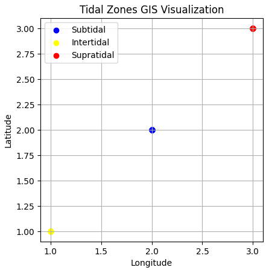
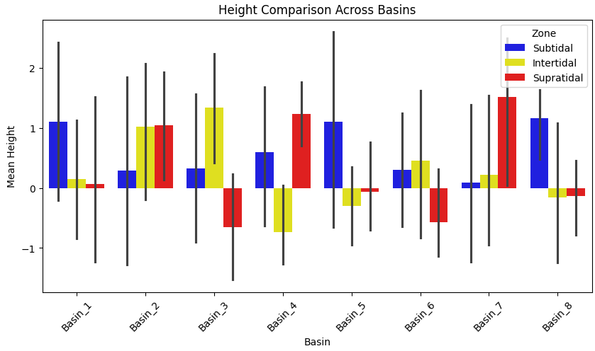
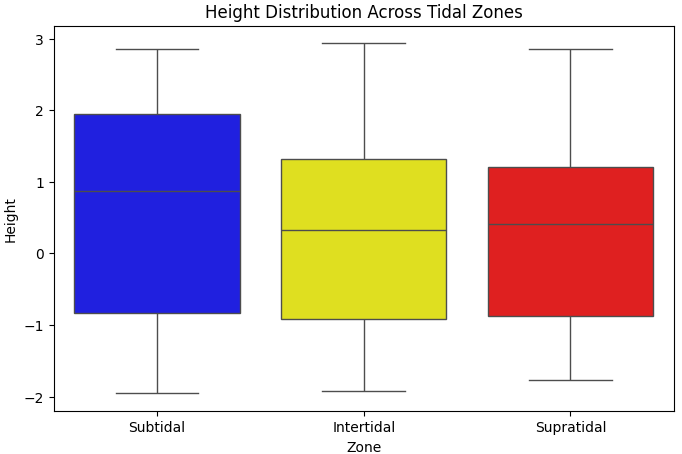
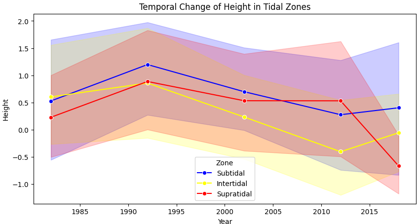
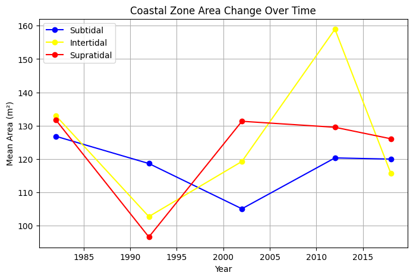

# Coastal Tidal Zones Analysis
### GIS · Python · Spatial Analysis · Temporal Data Analytics

An end-to-end GIS and data analytics portfolio project exploring the spatial and temporal characteristics of coastal tidal zones using Python, geospatial processing, statistical analysis, and scientific visualization.

> **Data transparency:** This project uses a synthetic dataset created for portfolio and analytical workflow demonstration. The results do not represent measurements from a real coastal monitoring program.

## Project Overview

Coastal environments are shaped by tidal processes and changing environmental conditions. This project demonstrates how tabular data can be transformed into geospatial datasets, analyzed over time, and presented through reproducible analytical workflows.

The analysis focuses on three coastal tidal zones:

- 🟡 **Intertidal Zone** — the area between high and low tide, alternately exposed and submerged
- 🔵 **Subtidal Zone** — the area that normally remains underwater
- 🔴 **Supratidal Zone** — the area above normal tidal influence that may be affected by exceptional tides or wave action

The project covers a synthetic time series from **1982 to 2018**.

## Project Objectives

- Explore temporal patterns across coastal tidal zones
- Compare distributions and variations in the dataset
- Process and manage spatial data with Python GIS libraries
- Create GIS outputs in GeoPackage format
- Integrate analytical workflows with SQLite
- Generate clear statistical and geospatial visualizations
- Demonstrate reproducible GIS and data analytics skills

## Technologies

| Area | Tools |
|---|---|
| Programming | Python |
| Data analysis | Pandas, NumPy |
| GIS and spatial processing | GeoPandas, Shapely |
| Geospatial data format | GeoPackage (`.gpkg`) |
| Database | SQLite |
| Visualization | Matplotlib, Seaborn |
| Development | Jupyter Notebook, Git, GitHub |

## Analytical Workflow

1. **Data preparation** — prepare the synthetic tidal dataset.
2. **Temporal analysis** — explore changes across the 1982–2018 period.
3. **Statistical analysis** — compare distributions and patterns across tidal zones.
4. **Geospatial processing** — transform tabular records into spatial data structures.
5. **Data storage** — integrate the analytical workflow with SQLite.
6. **Visualization** — create plots and maps to communicate the results.
7. **Interpretation** — summarize patterns and limitations without presenting synthetic results as real-world observations.

## Visual Results

The repository contains the following visual outputs.

### GIS Visualization



### Height Comparison Across Basins



### Height Distribution Across Tidal Zones



### Temporal Change in Tidal Zones



### Coastal Zone Area Change Over Time



Additional plots are available in the `figures/` directory.

## Key Observations

The current analysis of the synthetic dataset illustrates patterns such as:

- Differences in temporal variability between tidal zones
- Differences in height distributions across zones and basins
- Changes in simulated coastal-zone area over time

**Interpretation note:** These are observations from synthetic data and should not be interpreted as evidence of actual environmental change. Real-world conclusions would require validated observational data and appropriate scientific context.

## Repository Structure

```text
GIS-Tidal-Zones-Analysis-Project/
│
├── data/
│   ├── tidal_data.csv
│   └── tidal_data.gpkg
│
├── figures/
│   ├── Coastal-Zone-Area-change-Over-time.png
│   ├── Dataset.png
│   ├── Height-Comparison-Across-Basins.png
│   ├── Height-Distribution-Across-Tidal-Zones.png
│   ├── Height-Distribution-Shape-per-Zone.png
│   ├── Temporal-Change-of-Height-in-Tidal-Zone.png
│   └── Tidal-Zone-GIS-Visualization.png
│
├── src/
│   ├── analysis.py
│   ├── gis_processing.py
│   ├── main.py
│   └── visualization.py
│
├── notebook.ipynb
├── requirements.txt
├── .gitignore
└── README.md
```

## Getting Started

### 1. Clone the repository

```bash
git clone https://github.com/AramMehraban/GIS-Tidal-Zones-Analysis-Project.git
cd GIS-Tidal-Zones-Analysis-Project
```

### 2. Create a virtual environment (recommended)

**Windows PowerShell:**

```powershell
python -m venv .venv
.\.venv\Scripts\Activate.ps1
```

If PowerShell blocks script activation, you can skip activation and use the Python executable inside the virtual environment directly.

### 3. Install dependencies

```bash
python -m pip install -r requirements.txt
```

### 4. Run the analysis

```bash
python src/main.py
```

You can also open `notebook.ipynb` in Jupyter Notebook or VS Code to explore the analysis interactively.

> **Note:** The commands above describe the intended workflow. Successful execution depends on the installed dependencies and the current implementation of the scripts.

## Skills Demonstrated

- GIS and geospatial data processing
- Spatial data handling with GeoPandas and Shapely
- Python-based data analysis
- Temporal and statistical analysis
- Working with CSV and GeoPackage datasets
- Database integration concepts using SQLite
- Scientific visualization and analytical communication
- Reproducible project organization and documentation

## Project Purpose

This project demonstrates a practical combination of GIS concepts and Python-based data analytics. It is intended as a portfolio example for roles such as:

- GIS Analyst
- Geospatial Data Analyst
- Junior Data Analyst
- GIS and Environmental Data Analytics Specialist

The project emphasizes transparent data documentation, structured processing, and clear visualization of analytical results.

## Author

**Aram Mehraban**

GIS & Data Analytics Portfolio

[GitHub Repository](https://github.com/AramMehraban/GIS-Tidal-Zones-Analysis-Project)
